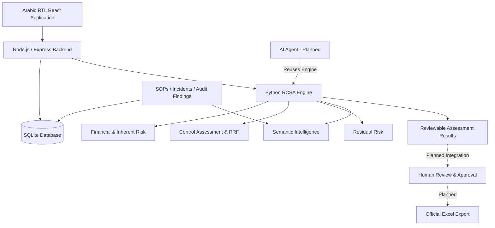

 <escape><div align="center"></escape>

# AI-Enhanced RCSA Platform

### Evidence-Driven Operational Risk & Control Self-Assessment for Banking

**Arabic-First • Human-Governed • Explainable AI**


*Transforming operational risk data into structured, transparent and evidence-based banking assessments.*

<escape></div></escape>

---

## Overview

**AI-Enhanced RCSA Platform** is an intelligent banking risk management solution designed to streamline the preparation, assessment, review, and governance of **Risk and Control Self-Assessments (RCSA)**.

The platform combines structured operational risk data, banking procedures, historical incidents, internal audit findings, deterministic risk calculations, and AI-assisted intelligence to support consistent and traceable assessments.

Built with an **Arabic-first, right-to-left (RTL)** interface, the platform aims to transform traditional spreadsheet-based RCSA workflows into a more efficient, explainable, and human-supervised digital experience.

### Core Objectives

- Automate complex operational risk calculations using verified banking methodologies.
- Improve consistency between risks, controls, incidents, audit findings, and assessment results.
- Support evidence-based risk identification and control evaluation.
- Reduce manual inconsistencies and repetitive assessment work.
- Maintain human oversight through review, approval, and audit processes.
- Enable structured assessment outputs aligned with banking RCSA templates.

> **Development Status:** The foundational application, financial assessment engine, control assessment engine, residual risk calculations, and semantic consistency modules have been implemented according to the latest development reports. Full interactive review, NFI/ESG assessments, Excel export, and AI Agent integration remain under development.

---

## Key Features

### Financial Risk Assessment

The deterministic Python engine supports:

- Individual financial impact assessment.
- Expected risk frequency normalization.
- Expected annual financial loss calculations.
- Five financial severity categories.
- Evidence-based historical incident analysis.
- Financial loss provenance and traceability.
- Official inherent risk heat-map evaluation.
- Missing financial data detection.

### Control Effectiveness & Residual Risk

The control assessment engine supports:

- Individual control evaluation.
- Preventive, detective, and corrective control classification.
- Automated, semi-automated, and manual execution methods.
- Official Risk Reduction Factor (RRF) calculations.
- Maximum eligible RRF selection.
- Residual financial risk calculations.
- Incident-to-control and audit-to-control evidence linking.
- Detection of potentially insufficient or partially relevant controls.

### Semantic Intelligence & Quality Validation

The platform includes Python modules for:

- Improving Arabic risk descriptions.
- Evaluating control relevance.
- Identifying inconsistencies between assessment fields.
- Proposing evidence-grounded assessment rationales.
- Suggesting targeted corrective actions.
- Distinguishing documentary evidence from AI-generated suggestions.
- Flagging missing data and unresolved assessment decisions.

Generated recommendations are subject to human review.

### Human-in-the-Loop Review

The planned integrated review workflow supports the following intended capabilities:

- Risk-by-risk and control-by-control review.
- Editing permitted assessment inputs.
- Completing missing information.
- Accepting or rejecting AI suggestions.
- Recalculating dependent assessment results.
- Preserving original and edited values.
- Maker–Checker review and approval.
- Version history and audit trails.

**Status:** Python review/recalculation functionality has been developed; complete end-to-end frontend, API, and persistence integration remains to be verified.

### Planned AI Agent

The document-driven AI Agent is intended to:

- Analyze SOPs, incident reports, audit findings, and supporting documents.
- Generate new RCSA assessment drafts.
- Update existing RCSA assessments.
- Suggest newly identified risks and controls.
- Identify missing information.
- Explain financial and control assessment results.
- Compare current and previous assessment versions.
- Submit generated assessments for human review.

The AI Agent will reuse the platform's deterministic assessment engines rather than independently generating financial calculations.

---

## System Architecture



### Technology Stack

| Component | Technology |
|---|---|
| Frontend | React, TypeScript |
| Backend | Node.js, Express |
| Database | SQLite |
| Risk Assessment | Python |
| Financial Calculations | Python Decimal |
| Data Sources | PDF, JSON, CSV, Excel references |
| Development Environment | Google AI Studio |
| Version Control | Git, GitHub |
| Testing | Python unittest, Node.js tests, TypeScript checks |

---

## RCSA Assessment Methodology

The risk assessment engine follows the registered project methodology references.

### Financial Risk Calculation

Expected annual financial loss:

\[
\text{Annual Expected Loss} = \text{Individual Expected Loss} \times \text{Frequency Multiplier}
\]

| Frequency | Annual Multiplier |
|---|---:|
| Once every two years | 0.5 |
| Annually | 1 |
| Every six months | 2 |
| Quarterly | 4 |
| Monthly | 12 |

### Financial Severity Levels

| Level | Financial Impact (EGP) |
|---|---|
| Low (L) | Greater than 0 to 150,000 |
| Medium (M) | Above 150,000 to 500,000 |
| High (H) | Above 500,000 to 1,500,000 |
| Very High (VH) | Above 1,500,000 to 3,000,000 |
| Critical (C) | Above 3,000,000 |

The engine preserves the official 5×5 assessment matrices separately from the annual financial classification.

Missing financial information is not automatically treated as zero.

### Risk Reduction Factor (RRF)

| Control Method | Preventive | Detective | Corrective |
|---|---:|---:|---:|
| Automated | 0.95 | 0.85 | 0.50 |
| Semi-Automated | 0.90 | 0.80 | 0.40 |
| Manual | 0.75 | 0.60 | 0.30 |

The platform uses the **maximum eligible RRF among implemented controls**.

```text
Effective RRF = MAX(Eligible Implemented Control RRFs)

Residual Annual Loss = Annual Expected Loss × (1 - Effective RRF)
```

Proposed future controls are excluded from current residual calculations.

Controls with unresolved scope or insufficient evidence are flagged for review.

### Non-Financial Impact (NFI)

The planned NFI engine evaluates four dimensions independently:

1. Service disruption.
2. Reputation and customers.
3. Regulatory exposure.
4. Legal exposure.

The overall NFI assessment follows the highest applicable impact severity, not an average.

Confirmed unaffected dimensions are displayed as `-`, while missing evidence remains pending.

---

## Data Integrity & Explainability

The platform distinguishes between:

- Original source values and calculated results.
- Historical incident losses and reference estimates.
- Confirmed control deficiencies and AI-suggested findings.
- Missing information and verified zero values.
- Implemented controls and proposed corrective controls.
- Original assessment text and suggested improvements.

The goal is to ensure that every material risk assessment conclusion can be traced back to supporting data or an authorized reviewer decision.

---

## Project Structure

```text
RCSA_Platform/
│
├── src/
│   ├── pages/
│   └── server/
│
├── rcsa_engine/
│   ├── __init__.py
│   ├── models.py
│   ├── financial_inherent.py
│   ├── control_residual.py
│   └── semantic_intelligence.py
│
├── reference_data/
│
├── tests/
│
├── package.json
│
└── README.md
```

*The structure shows key modules reported during development. Additional files and folders may vary by branch.*

---

## Getting Started

### Prerequisites

- Node.js compatible with the repository configuration.
- Python and required assessment dependencies.
- Git.
- Project reference datasets.

### Clone Repository

```bash
git clone https://github.com/ShahdMohamed10/RCSA_Platform.git
cd RCSA_Platform
```

### Install Dependencies

```bash
npm install
```

### Run Available Tests

```bash
npm test
```

### Build Application

```bash
npm run build
```

### Python Engine Tests

```bash
python -m unittest discover -s tests -p "test_*.py" -v
```

Check `package.json` and the project's environment configuration for the appropriate application startup command.

Do not commit private API keys, `.env` secrets, customer information, or sensitive banking records.

---

## Development Status

Based on the latest supplied development report:

| Verification | Reported Result |
|---|---|
| Python calculation, semantic and integrity tests | 55 passed |
| Node.js application tests | 20 passed |
| TypeScript validation | Passed |
| Application build | Passed |

These results are based on development reports and should not be interpreted as independent production certification.

### Development Roadmap

- [x] Banking application foundation and Arabic RTL interface.
- [x] Financial risk assessment engine.
- [x] Inherent risk methodology and heat maps.
- [x] Control assessment and RRF calculation.
- [x] Residual financial risk engine.
- [x] Semantic intelligence and consistency validation modules.
- [ ] Complete Human-in-the-Loop frontend/backend integration.
- [ ] Non-Financial Impact assessment.
- [ ] ESG and final RCSA classification.
- [ ] Official Excel template export.
- [ ] Fully integrated AI Agent.
- [ ] Production readiness and end-to-end validation.

---

## Security & Responsible AI

The platform is designed around banking risk-governance principles, including:

- Role-based access control.
- Maker–Checker separation.
- Human approval of AI-generated recommendations.
- Auditability and assessment traceability.
- Version integrity.
- Controlled handling of financial and risk-related data.

The project uses development and demonstration data unless otherwise specified.

**AI-generated assessments should not be treated as official banking decisions without appropriate human validation.**

This repository does not imply endorsement or certification by the National Bank of Egypt.

---

## Author

**Shahd Mohamed**

Computer Science Graduate | AI & Machine Learning

GitHub: [ShahdMohamed10](https://github.com/ShahdMohamed10)

---

<escape><div align="center"></escape>

### Building Explainable, Evidence-Driven Banking Risk Intelligence

*Accurate calculations. Traceable evidence. Human accountability.*

<escape></div></escape>
